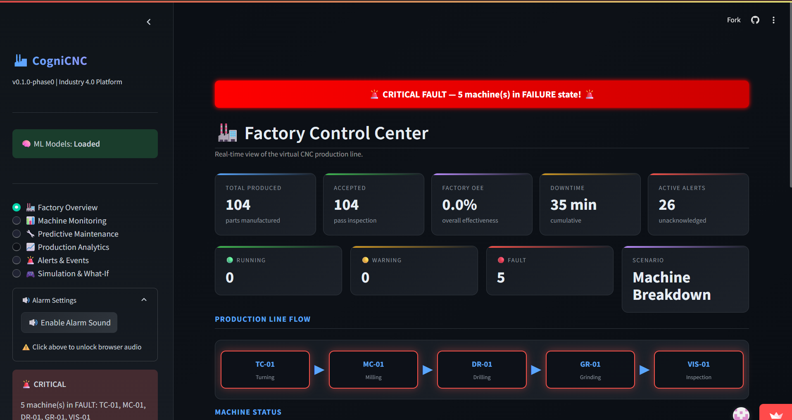

# 🏭 CogniCNC: Industry 4.0 Smart CNC Monitoring, Predictive Maintenance & Explainable AI Platform

[](https://www.python.org/)
[](https://streamlit.io/)
[](https://scikit-learn.org/)
[](https://www.sqlite.org/)
[]()
[]()

> **Live Demo:** [🚀 Experience CogniCNC on Streamlit Cloud](https://cognicnc-id-40-dczcyxvhtqz3ecmkwgk92c.streamlit.app/)

 

---

## 📖 Overview

CogniCNC is an end-to-end **Industry 4.0 Smart Manufacturing Platform** that combines virtual CNC machine telemetry simulation, dual-layer predictive maintenance machine learning, unsupervised anomaly detection, automated industrial decision support, and real-time Overall Equipment Effectiveness (OEE) analytics — all presented through an interactive dark-themed control-room dashboard.

Built as a B.Tech AI & Data Science capstone project, CogniCNC demonstrates how modern AI/ML pipelines can be integrated into smart factory environments for proactive maintenance and production optimization.

> ⚠️ **Note:** This is a research/educational project. It is **not** a validated industrial deployment or a fully connected digital twin. Real-sensor integration can later be added through the telemetry interface, with appropriate calibration and validation required before industrial use.

---

## 🏗️ System Architecture

### Visual Data Flow
```mermaid
flowchart TB
    subgraph Data Sources
        direction LR
        VFS[Virtual Factory Simulator<br/>5 CNC Stations]
        UCI[UCI AI4I 2020 Dataset<br/>10,000 Records, 14 Columns]
    end

    ML[Dual-Layer ML Inference Engine<br/>Layer A: Random Forest Failure Classifier<br/>Layer C: Isolation Forest Anomaly Detector]
    RULES[Rule-Based Decision Engine<br/>Urgency: LOW → CRITICAL<br/>Actions: Monitor / Schedule / Inspect / Shutdown]
    ALERT[Alert Deduplication Service<br/>30-second cooldown window]

    subgraph Output & UI
        direction LR
        DB[(SQLite WAL Database)]
        UI{{Streamlit Dashboard}}
    end

    VFS -- 16-field Telemetry --> ML
    UCI -- 6 ML Features --> ML
    ML -- Failure Prob + Anomaly Score --> RULES
    RULES -- Action Plans --> ALERT
    ALERT --> DB
    ALERT --> UI


